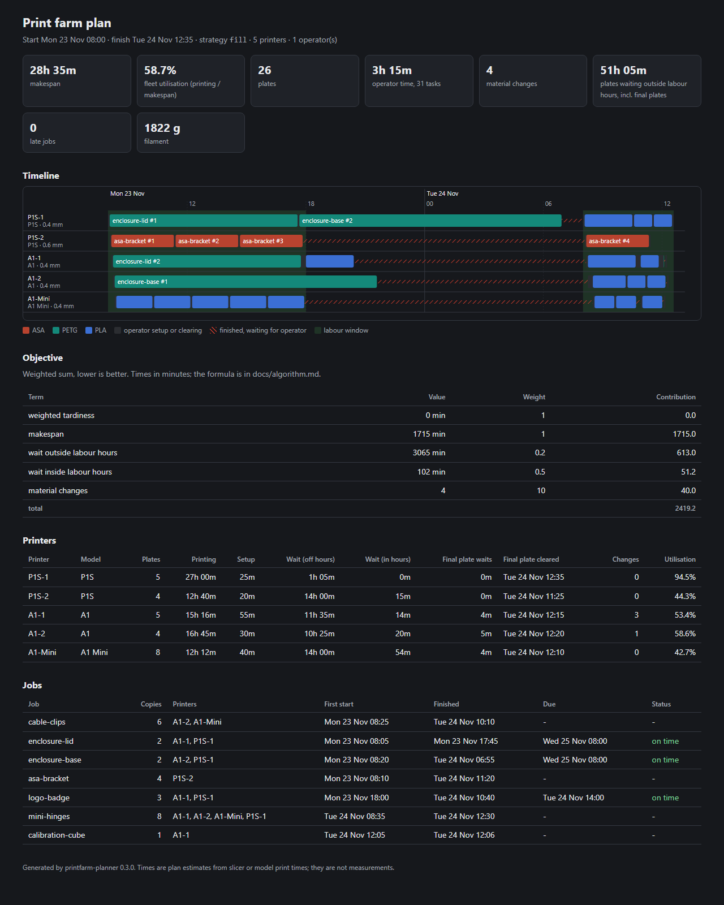
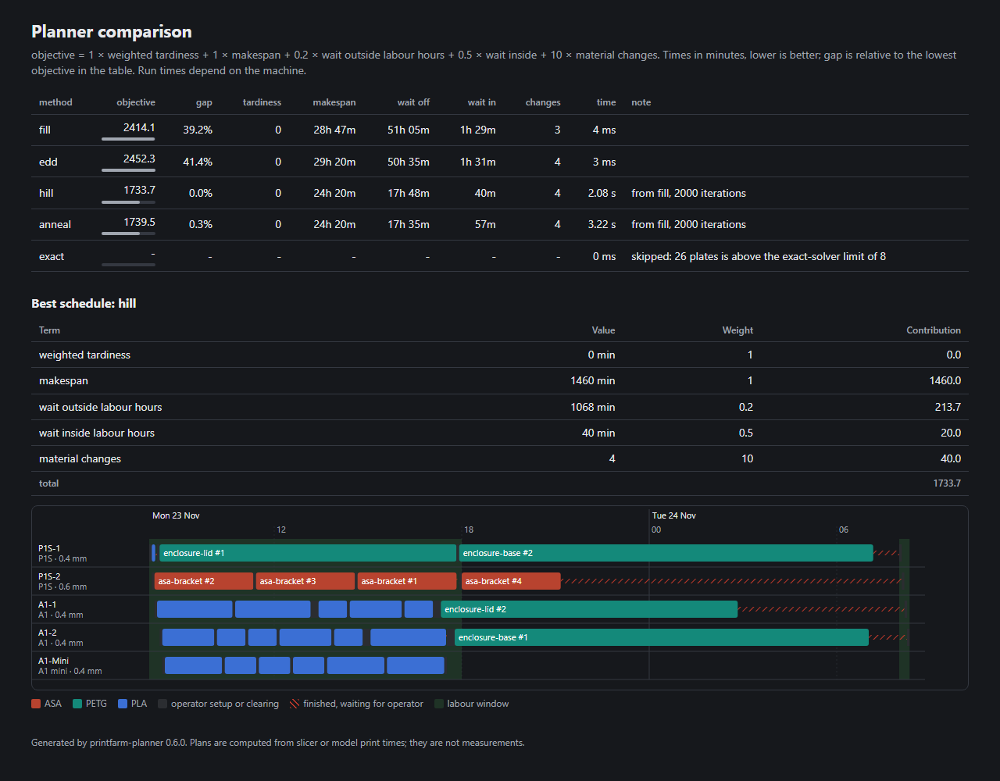

# printfarm-planner

[](https://github.com/projectbin07-stack/printfarm-planner/actions/workflows/ci.yml)
[](LICENSE)

Plans a production run across a mixed 3D-printer fleet (Bambu Lab P1S, P1P, X1 Carbon, A1 and
A1 mini, or your own models), taking into account when someone is actually there to change plates.



## Why

On a small print farm, the bottleneck is often the person, not the printer. A 13-hour plate
started at 17:40 finishes overnight and waits on the bed until morning, which is fine. The same
plate started at 08:00 finishes at 21:15 and leaves the printer idle all night. Material is
another constraint: an ASA job cannot go to an open-frame A1, a four-colour badge needs an AMS,
and swapping spools costs operator time.

Spreadsheets and slicer queues do not model any of that. `printfarm-planner` takes a fleet
description, labour hours and a list of jobs, and produces a schedule, utilisation figures and a
Gantt chart you can open in any browser. It reads [gcode-insight](https://github.com/projectbin07-stack/gcode-insight)
JSON directly, so print time, filament, nozzle and size can come from the sliced file.

## Features

- **Fleet file** (JSON): built-in P1S / P1P / X1 Carbon / A1 / A1 mini models, plus your own
  custom models. Build volumes, enclosure, nozzle sizes and AMS capacity come from Bambu Lab's
  published specifications, by way of the printer and material registry shared with gcode-insight,
  print-forge and stl-doctor. Each printer has a nozzle size, AMS slots, allowed
  materials, the spools loaded at the start, an optional speed `time_factor`, and a `count` for
  identical machines.
- **Labour windows**: weekday ranges (`mon-fri`), split shifts, shifts that run past midnight,
  or `24/7`. Plate changes, material changes and clearing each printer's final plate are operator
  tasks that must fit inside a window, and each operator does one task at a time. The plan ends
  when the last final plate is cleared.
- **Jobs** from a CSV plan, from `gcode-insight analyze --json` files, or both. A CSV row can
  point at a JSON analysis and override any field.
- **Compatibility checks** with reasons: material, filament count against AMS slots, nozzle,
  bed fit (including a 90 degree rotation), and which printer models the file was sliced for.
- **Two greedy strategies**: `fill` minimises the time finished plates wait for an operator, and
  `edd` runs earliest due date first. Both honour job priority and avoid unnecessary material
  changes.
- **Explicit objective**: a weighted sum of priority-weighted tardiness, makespan, waiting outside
  and inside labour hours (including final plates waiting to be cleared), and material changes. Every term is reported separately, and the
  weights are set with `--weight`. The formula is in [docs/algorithm.md](docs/algorithm.md).
- **Local search** (`plan --improve hill|anneal`): move, swap and reassign-printer moves on top
  of the greedy schedule, with hill climbing or simulated annealing. Seeded and deterministic for
  an iteration budget, with an optional time limit. It never returns a plan worse than its start.
- **Exact solver for small instances**: branch-and-bound over plate-to-printer assignment and
  order, up to 8 plates by default. The tests use it to measure how far the heuristics are from
  the optimum.
- **`compare` command**: runs `fill`, `edd`, hill climbing, annealing and the exact solver on the
  same input, with a table of objective terms and run times (text, JSON or HTML).
- **Metrics**: makespan, utilisation per printer and for the fleet, operator time, material
  changes, waiting time split into outside and inside labour hours, and lateness per job.
- **Outputs**: terminal text, CSV, JSON, and a self-contained HTML Gantt report with no scripts
  or external assets. It follows the system light/dark setting.
- No runtime dependencies (standard library only), Python 3.10 or newer.

## Install

Not on PyPI yet. Install from the repository:

```console
pip install git+https://github.com/projectbin07-stack/printfarm-planner.git
```

or from a clone with `pip install -e .`

## Quick start

The repository ships an example fleet (two P1S, two A1 and one A1 mini, one operator Mon-Fri
08:00-18:00 and Saturday morning) and an example order. **The jobs are invented demonstration
data, not a real order book, and their print times are not measured.**

```console
printfarm-planner plan --fleet examples/fleet.json examples/jobs.csv --start 2026-11-23T08:00 --html plan.html --csv plan.csv
```

Output (first part; the full text also lists every plate and job):

```text
Production plan (strategy: fill)

  Start Mon 23 Nov 08:00   Finish Tue 24 Nov 12:46   Makespan 28h 47m
  26 plates, 83h 58m printing, fleet utilisation 58.4%
  Operator: 31 tasks, 3h 05m, 3 material changes
  Finished plates waiting: 51h 05m outside labour windows, 1h 29m inside
  Of that, final plates waiting to be cleared: 0m
  Filament: 1822.2 g

Objective (lower is better; minutes, weighted)
  term                          value  weight  contribution
  weighted tardiness            0 min       1           0.0
  makespan                   1727 min       1        1726.5
  wait outside labour hours  3065 min     0.2         613.0
  wait inside labour hours     89 min     0.5          44.5
  material changes                  3      10          30.0
  total                                              2414.1

Printers (wait off / wait in include the final plate's wait)
  printer  model    plates  printing  setup  wait off  wait in  final wait  cleared            util
  P1S-1    P1S           6   27h 07m    30m    1h 05m       0m          0m  Tue 24 Nov 12:46  94.2%
  P1S-2    P1S           4   12h 40m    20m   14h 00m      15m          0m  Tue 24 Nov 11:25  44.0%
  A1-1     A1            4   15h 15m    40m   11h 35m      10m          0m  Tue 24 Nov 11:55  53.0%
  A1-2     A1            4   16h 45m    30m   10h 25m      15m          0m  Tue 24 Nov 12:15  58.2%
  A1-Mini  A1 mini       8   12h 12m    40m   14h 00m      49m          0m  Tue 24 Nov 12:05  42.4%
```

The 31 operator tasks are 26 plate starts and 5 clearings of final plates. The same input with
`--strategy edd` gave a 29h 20m makespan, 4 material changes and 50h 35m of off-hours waiting,
11h 01m of it final plates left overnight, for an objective of 2452.3 against 2414.1 for `fill`.

These figures changed in v0.4.0 for two reasons. `calibration-cube` now comes from a gcode-insight
0.2.0 analysis that says it was sliced for a P1S, so it can only go to P1S-1. And a job whose spool
has no colour label (or whose slicer colour `#161616` is the loaded `PETG:black`) no longer counts
a material change against a labelled spool of the same type.
Neither strategy is better in general: both are greedy heuristics, so try both on your own
order.

### Improving a plan and comparing planners

`compare` runs every planner on the same input. On the same invented example:

```console
$ printfarm-planner compare --fleet examples/fleet.json examples/jobs.csv --start 2026-11-23T08:00
Planner comparison (26 plates)

  objective = 1 x tardiness + 1 x makespan + 0.2 x wait off + 0.5 x wait in + 10 x changes
  times in minutes; gap is relative to the lowest objective in this table

  method  objective    gap  tardiness  makespan  wait off  wait in  changes    time  note
  fill       2414.1  39.2%          0   28h 47m   51h 05m   1h 29m        3    5 ms
  edd        2452.3  41.4%          0   29h 20m   50h 35m   1h 31m        4    4 ms
  hill       1733.7   0.0%          0   24h 20m   17h 48m      40m        4  2.37 s  from fill, 2000 iterations
  anneal     1739.5   0.3%          0   24h 20m   17h 35m      57m        4  2.83 s  from fill, 2000 iterations
  exact           -      -          -         -         -        -        -    0 ms  skipped: 26 plates is above the exact-solver limit of 8
```

What this shows, and what it does not:

- The local search lowers the objective by 28% (hill climbing, 1733.7) and 28% (annealing,
  1739.5) against the better greedy plan, mostly by cutting overnight waiting from about 51 hours
  to about 18 hours. The improved plans still let long plates print overnight, but time them to
  finish closer to Tuesday 08:00, when they are cleared. Most of their remaining wait is final
  plates: 18h 18m for hill climbing and 18h 08m for annealing, 10h 55m of it on P1S-2, the only
  printer that can run the ASA job.
- **v0.2.0 overstated this improvement.** Its objective did not count the final plate's wait
  and did not schedule clearing it, so it showed hill climbing at 1332.5 with 0m of off-hours
  waiting, 42.4% below the better greedy plan (then `edd`). Re-timed and scored with clearing,
  that same v0.2.0 plan has 32h 52m of off-hours waiting and an objective of 1907.0. The
  improvement is still there, but it is smaller than v0.2.0 reported (23-28% on the v0.3.0
  example).
- The result depends on the seed. With seeds 0 to 4, hill climbing ended between 1719.2 and
  1860.2, and annealing between 1733.7 and 1866.7. Annealing was not consistently better.
- With 26 plates the exact solver is skipped, so there is no proof of how far these plans are
  from the optimum. Run times are from the development machine.

For an instance small enough for the exact solver, `examples/small-jobs.csv` has 8 plates (also
invented):

```console
$ printfarm-planner compare --fleet examples/fleet.json examples/small-jobs.csv --start 2026-11-23T08:00
Planner comparison (8 plates)

  objective = 1 x tardiness + 1 x makespan + 0.2 x wait off + 0.5 x wait in + 10 x changes
  times in minutes; gap is relative to the lowest objective in this table

  method  objective    gap  tardiness  makespan  wait off  wait in  changes    time  note
  fill       1845.5  26.8%        125   24h 10m   22h 20m       5m        0    1 ms
  edd        2057.5  41.4%        145   24h 15m   36h 15m      25m        1    1 ms
  hill       1455.0   0.0%          0   24h 05m       50m       0m        0  468 ms  from fill, 2000 iterations
  anneal     1455.0   0.0%          0   24h 05m       50m       0m        0  449 ms  from fill, 2000 iterations
  exact      1455.0   0.0%          0   24h 05m       50m       0m        0   58 ms  optimal in the sequence model, 534 nodes
```

Both greedy strategies finish `logo-badge` after its 10-hour due time, and both leave two
printers holding a finished plate from Monday evening until Tuesday 08:00. The local search and
the exact solver find a plan where nothing is late and the 13h 15m `enclosure-base` plate starts
at 17:55 after an `enclosure-lid` plate, so it finishes at 07:10, just before it is cleared. Every
plan ends on Tuesday morning, because some plate always prints past 18:00 and has to be cleared
the next day. "Optimal in the sequence model" means optimal over plate orders per printer timed
by the planner's dispatch rule, not over every conceivable timetable
([docs/algorithm.md](docs/algorithm.md#5-exact-solver-for-small-instances-exactpy)).

v0.2.0 reported 940.0 for `fill` and 810.0 for the optimum on this input, with makespans around
13.5 hours and no waiting, because the final plates were never cleared in its plans.

On generated instances the local search is not always optimal. Over 40 instances of 7 plates,
hill climbing reached the exact optimum on 28, with a mean gap of 3.3%, and stayed 78% above it
on one; annealing reached it on 34. On 10 of 40 instances of 5 plates hill climbing did not
improve on the greedy start at all, in many of them because the greedy plan was already optimal.
The full table is in [docs/algorithm.md](docs/algorithm.md#6-measured-gaps).



To use the improved plan, add `--improve hill` (or `anneal`) to `plan`. Weights are changed per
term, for example `--weight makespan=0.5 --weight material_changes=30`.

Check which printers can run which jobs, without scheduling:

```console
$ printfarm-planner check --fleet examples/fleet.json examples/jobs.csv
cable-clips       P1S-1, A1-1, A1-2, A1-Mini
enclosure-lid     P1S-1, A1-1, A1-2
enclosure-base    P1S-1, A1-1, A1-2
asa-bracket       P1S-2
logo-badge        P1S-1, A1-1, A1-2
mini-hinges       P1S-1, A1-1, A1-2, A1-Mini
calibration-cube  P1S-1
```

When a job has no capable printer, `check` prints each printer's reasons, and `plan` lists the
job under "Unscheduled" and exits with status 1.

### Using gcode-insight output

```console
gcode-insight analyze bracket.gcode --json --out bracket.json
printfarm-planner plan --fleet fleet.json bracket.json --copies 6 --start 2026-11-23T08:00
```

`--out` needs gcode-insight 0.2.0 or later. Shell redirection (`--json > bracket.json`) also works,
including in Windows PowerShell 5.1, which writes UTF-16 or UTF-8 with a byte-order mark: the
planner reads JSON, CSV and fleet files in UTF-8 with or without a BOM, and UTF-16 with a BOM.

For each analysis, the job uses:

| Field | Taken from |
|---|---|
| print time | the slicer's total estimate in the file. If there is none, gcode-insight's model estimate plus `--prep-min` (the model excludes heating, homing and levelling). |
| spools | each tool that extruded: gcode-insight's material, falling back to the slicer's filament type, then `--material`; plus the slicer's filament colour when the file has one (gcode-insight 0.2.0+), for example `PLA:#161616` |
| models | the printer model the file was sliced for (gcode-insight 0.2.0+), with a `Bambu Lab ` prefix dropped: `Bambu Lab P1S` -> `P1S`. The job then runs only on printers of that model. A file sliced for a model your fleet does not have (`Voron 2.4 350`) has no printer; set the CSV `models` column to override. |
| nozzle | slicer metadata, if present |
| size | extent of all moves (X/Y span, max Z). This includes purge lines, so it can overstate the part. |
| mass | gcode-insight's mass estimate |

Output of gcode-insight 0.1.0 (no `schema_version`) still loads: its spools have no colour and the
job may run on any compatible model.

How spools are matched against what a printer has loaded: the material type must be equal. If
either side has no colour label (`PLA`), any spool of that type serves. Otherwise the labels must
name the same colour, where a `#RRGGBB` code counts as the nearest of a small table of reference
colours (black, white, grey, silver, red, maroon, orange, yellow, gold, green, olive, cyan, blue,
navy, purple, magenta, pink, brown, beige). So the slicer's `#161616` matches a spool labelled
`black`, and `#FFFFFF` matches `white`. Other labels (`galaxy`) must match as written, ignoring
case. The hex mapping is a heuristic: two different dark reds can both map to `maroon`.

## Input formats

### Fleet file

```json
{
  "labour": {
    "windows": {"mon-fri": "08:00-18:00", "sat": "09:00-13:00"},
    "operators": 1,
    "plate_change_min": 5,
    "material_change_min": 10
  },
  "models": {
    "BigBox": {"bed_mm": [350, 350, 400], "enclosed": true, "materials": ["PLA", "PETG", "ABS"]}
  },
  "printers": [
    {"name": "P1S-1", "model": "P1S", "nozzle_mm": 0.4, "ams_slots": 4,
     "loaded": ["PLA:black", "PLA:white"]},
    {"name": "A1", "model": "A1", "count": 2, "ams_slots": 4},
    {"name": "Mini", "model": "A1 mini", "time_factor": 1.1}
  ]
}
```

- `windows` takes a day spec (`mon`, `mon-fri`, `fri-mon`, `sat,sun`, `daily`) mapped to one or
  more `HH:MM-HH:MM` ranges (`"08:00-12:00, 13:00-17:00"`). A range that ends before it starts
  runs past midnight. Use `"windows": "24/7"` for an always-staffed farm. The default is Mon-Fri
  08:00-18:00.
- `model` is a built-in model or a custom one from `models`. Built-in models also accept the
  registry's aliases and full names: `X1C`, `a1-mini`, `Bambu Lab X1 Carbon`.
- `ams_slots` is the number of spools available without a manual swap: 4 per AMS or AMS lite,
  and 0 for the external holder only (one spool). For built-in models it may not exceed what
  Bambu Lab documents (16: four 4-slot AMS units).
- `materials` overrides the model's allowed material types. The built-in defaults are
  conservative: open-frame printers are not offered ABS, ASA, PC or PA. Run `printfarm-planner
  models` to see them.
- `loaded` lists the spools on the printer at plan start. If it is empty, the printer is assumed
  to be prepared for its first plate.
- `time_factor` multiplies every print time on that printer. It is your own estimate, for
  example for a printer you run in a slower profile. The tool does not measure it.

### Jobs CSV

```csv
name,copies,print_time,material,nozzle_mm,size_mm,mass_g,due,priority,models,gcode_json
enclosure-lid,2,9h30m,PETG:black,0.4,220x160x30,210,48,1,P1S+A1,
logo-badge,3,2:25,PLA:white+PLA:orange,0.4,80x80x6,22,2026-11-24T14:00,0,,
bracket,6,,,,,,,0,,analyses/bracket.json
```

| Column | Meaning |
|---|---|
| `name` | required, unique |
| `copies` | number of plates (default 1) |
| `print_time` | per plate: minutes (`90`), `H:MM` or `1h30m`. Required unless `gcode_json` is given. |
| `material` | spools joined with `+`. Each spool is a type, optionally with `:label` (colour). The type is checked against the printer, and the full name decides whether a spool swap is needed. |
| `nozzle_mm`, `size_mm` (`XxYxZ`), `mass_g` | optional; used for checks and totals |
| `due` | hours after the plan start, or an ISO date-time. A date-time with a UTC offset (`2026-11-24T14:00+01:00`) is converted to local time (or to `--start`'s offset, if it has one). |
| `priority` | integer, higher is scheduled first (default 0) |
| `models` | printer models the file was sliced for, joined with `+`. Empty means the model from `gcode_json`, or any model when there is none. |
| `gcode_json` | path to a gcode-insight analysis, relative to the CSV. Values in the row override it. When an overriding value is clearly different (print time or mass more than 10% apart, another material or colour, another nozzle, other models), the job gets a `warning:` note and the warning is printed to stderr. Leave a column empty to use the analysis. |

Lines starting with `#` are ignored.

## How the scheduler works

Times are minutes from `--start`, in naive local time.

1. Every plate start is an operator task lasting `plate_change_min`, plus `material_change_min`
   when the printer does not already hold all the spools the plate needs. The task must fit
   inside a single labour window, and an operator can only do one task at a time. Printing needs
   nobody, so prints run through nights and weekends.
2. The scheduler repeatedly takes the printer whose next possible operator slot comes first.
   From the plates that printer can run, it picks one by:
   - `fill`: priority, then the shortest time the finished plate would wait for the next labour
     window, then no material change, then earliest due date, then longest print, then plates
     that fewer printers can run.
   - `edd`: priority, then earliest due date, then no material change, then longest print, then
     the same flexibility tie-break.

   When the printer that comes first has nothing left that it can run, its final plate is
   cleared instead: an operator task of `plate_change_min` with the same window and operator
   rules. The plan ends when the last final plate is cleared, and a final plate that finishes
   at night waits, and counts as waiting, until then.
3. Loaded spools are tracked per printer. With an AMS, the most recently used spools stay
   loaded, up to the slot count.

This is a fast, explainable greedy heuristic. It does not search for an optimal schedule.

4. Optionally, `--improve hill|anneal` runs a local search over the plate order of each
   printer. Every candidate is re-timed with the same rules, and the best plan by the objective
   is kept. `compare` also runs a branch-and-bound exact solver when there are at most 8 plates.
   Both are described, with formulas, in [docs/algorithm.md](docs/algorithm.md).

## Architecture

```text
src/printfarm_planner/
  model.py      Printer models (built-in from the registry), printers, jobs, plates
  registry.py   Shared printer/material registry with print_registry.json (vendored unchanged
                from gcode-insight; CI checks the copy against the pinned release)
  fleet.py      Fleet JSON loader and validation
  labour.py     Weekly windows, lazily generated calendar, operator booking
  jobs.py       Jobs CSV and gcode-insight JSON loaders
  compat.py     Printer/job compatibility with reasons
  scheduler.py  Dispatcher shared by all planners, greedy list scheduler (fill / edd),
                sequence decoder (simulate)
  metrics.py    Utilisation, waiting split, lateness
  objective.py  Weighted objective and its terms
  search.py     Local search: move / swap / reassign, hill climbing or annealing
  exact.py      Branch-and-bound for small instances
  compare.py    Runs every planner on one input; text, JSON and HTML comparison
  report.py     Text, CSV and JSON output
  gantt.py      Self-contained HTML + SVG Gantt report
  cli.py        plan / compare / check / models
```

## Command reference

```text
usage: printfarm-planner [-h] [--version] {plan,compare,check,models} ...

    plan                build a schedule
    compare             run fill, edd, local search and the exact solver on
                        the same input
    check               show which printers can run which jobs
    models              list built-in printer models
```

```text
usage: printfarm-planner plan [-h] --fleet FLEET [--start START]
                              [--copies COPIES] [--material MATERIAL]
                              [--prep-min PREP_MIN] [--strategy {fill,edd}]
                              [--improve {hill,anneal}]
                              [--iterations ITERATIONS] [--time-limit SECONDS]
                              [--seed SEED] [--weight NAME=VALUE]
                              [--html HTML] [--csv CSV] [--json]
                              [--title TITLE]
                              inputs [inputs ...]

  inputs                jobs CSV file(s) and/or gcode-insight JSON analyses
                        (analyze --json)
  --fleet FLEET         fleet JSON file
  --start START         plan start, local time YYYY-MM-DDTHH:MM (default: the
                        next full hour)
  --copies COPIES       copies of each job given directly as a JSON analysis
                        (default 1)
  --material MATERIAL   material for JSON analyses whose filament type is
                        unknown, e.g. PLA
  --prep-min PREP_MIN   minutes added to gcode-insight model times (which
                        exclude heating and homing) when a file has no slicer
                        estimate (default 0)
  --strategy {fill,edd}
                        fill: minimise finished plates waiting for an
                        operator; edd: earliest due date first (default fill)
  --improve {hill,anneal}
                        run a local-search improvement phase on the greedy
                        schedule: hill climbing or simulated annealing
  --iterations ITERATIONS
                        local-search iteration budget (default 2000)
  --time-limit SECONDS  local-search wall-clock limit; results then depend on
                        machine speed
  --seed SEED           local-search random seed (default 0)
  --weight NAME=VALUE   objective weight, repeatable; NAME is one of
                        tardiness, makespan, wait_off, wait_in,
                        material_changes (defaults: tardiness=1, makespan=1,
                        wait_off=0.2, wait_in=0.5, material_changes=10)
  --html HTML           write a Gantt HTML report here
  --csv CSV             write the schedule as CSV here
  --json                print JSON instead of text
  --title TITLE         HTML report title
```

```text
usage: printfarm-planner compare [-h] --fleet FLEET [--start START]
                                 [--copies COPIES] [--material MATERIAL]
                                 [--prep-min PREP_MIN]
                                 [--iterations ITERATIONS]
                                 [--time-limit SECONDS] [--seed SEED]
                                 [--weight NAME=VALUE] [--exact-limit PLATES]
                                 [--html HTML] [--json] [--title TITLE]
                                 inputs [inputs ...]

  (input, --iterations, --time-limit, --seed and --weight options as for plan)
  --exact-limit PLATES  run the exact solver only up to this many plates
                        (default 8; run time grows steeply)
  --html HTML           write an HTML comparison report here
  --json                print JSON instead of text
  --title TITLE         HTML report title
```

`compare` starts both local searches from whichever greedy plan has the lower objective. `check`
takes the same input options as `plan`. Exit status: 0 for success, 1 when some job cannot run
on any printer, and 2 for invalid input.

## Testing

```console
pip install -e ".[dev]"
ruff check . && ruff format --check . && mypy && pytest --cov
```

The 326 tests include scheduler scenarios with timelines worked out by hand (for example, a
12-hour plate started Monday 08:05 ends at 20:05, its successor is set up at Tuesday 08:00, and
the final plate is cleared Wednesday 08:00). They also cover calendar edge cases (weekends,
shifts past midnight, windows too short for a task), operator contention, including two final
plates competing for one operator, and loading the real JSON output of gcode-insight 0.1.0 and
0.2.0. CI runs on Ubuntu and Windows with Python 3.10 and 3.13. A separate `interop` job installs
gcode-insight v0.2.0, analyses the G-code fixtures with it and checks that the live output imports
the same as the committed JSON, including a PowerShell 5.1 `>` redirect on Windows.

For the planners added in v0.2.0, the tests check objective terms against hand-derived values,
check that the local search never returns a worse plan than its start and that every plan it
returns still respects labour windows, operator capacity and compatibility and clears every
final plate, and check that runs are repeatable for a seed. They also compare the exact solver
against brute-force enumeration on 16 generated instances, and pin the optimality gaps measured
by `tests/gap_study.py` (`python tests/gap_study.py` prints them).

## Known limitations

- **Not yet used on a real farm.** The example order is invented, and no plan from this tool has
  been compared against what happened on real printers.
- Print times are slicer or model estimates. Failures, reprints, first-layer checks and
  maintenance are not modelled.
- `fill` and `edd` are greedy heuristics, and the local search can stop in a local optimum
  (measured gaps are in [docs/algorithm.md](docs/algorithm.md#6-measured-gaps)). Only instances
  of up to about 8 plates can be solved exactly, and "exact" means optimal over plate orders
  timed by the planner's dispatch rule, not over every possible timetable.
- The default objective weights are a judgement call, not calibrated on a real farm. Different
  weights give different "best" plans.
- Final plates: since v0.3.0 each printer's final plate is cleared in the plan and its wait
  counts in the objective (v0.2.0 did neither, and so understated the wait of improved plans;
  see [CHANGELOG.md](CHANGELOG.md)). Clearing is assumed to take `plate_change_min`, the same as
  a plate change. Tardiness still uses the time a plate finishes printing, not when it is taken
  off the bed, so a job that finishes at 02:00 before a 06:00 due time counts as on time. The
  CSV export lists plates only; the clearing tasks are in the text, JSON and HTML output.
- Loading AMS spools is assumed to happen within `material_change_min`.
- The local search with a `--time-limit` is not repeatable across machines. The default
  2000-iteration budget took 2.4 to 3.3 s for the 26-plate example on the development machine
  (it varies with machine load).
- Material compatibility is by type only. TPU in an AMS, hardened nozzles for CF filaments and
  similar rules are left to your own `materials` lists.
- Wall-clock times are naive local time, so daylight-saving changes are not modelled.
- Built-in material defaults are a conservative choice, not manufacturer limits.

## Roadmap

- Plate-batching: put several small jobs on one plate when they share material.
- Optionally measure tardiness at plate removal instead of print end.
- Faster incremental re-timing in the local search, for larger orders.
- Downtime and maintenance windows per printer.
- Read `.gcode.3mf` plate lists through gcode-insight.

## License

MIT, see [LICENSE](LICENSE).
